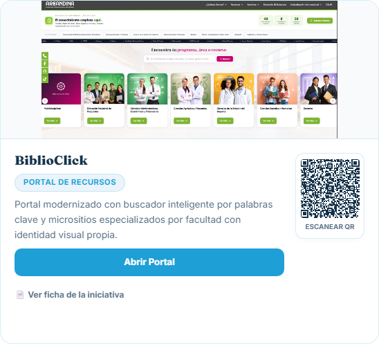
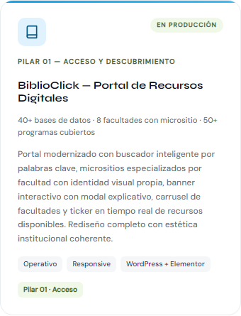
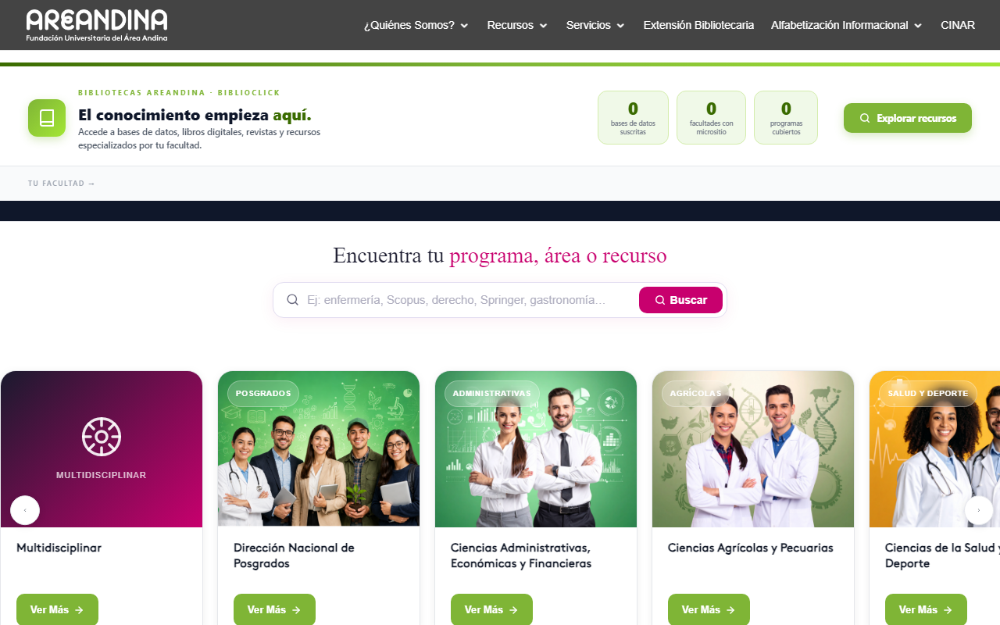

# 01 · BiblioClick

**Portal de recursos** · Experiencia al Usuario · Estado en el tablero: **En operación**

## Qué es

Portal modernizado con buscador inteligente por palabras clave y micrositios especializados por facultad con identidad visual propia.

- **Definición:** Portal de recursos digitales organizados por facultad, con buscador inteligente por palabras clave y micrositios especializados con identidad visual propia.
- **Objetivo:** Eliminar las barreras entre el usuario y la información científica facilitando un acceso integrado e intuitivo a los recursos suscritos.
- **Comunidades:** Estudiantes, docentes e investigadores de todas las facultades.

## En el tablero

## En la biblioteca digital (bidig)

Tarjeta en [BiblioNova en bidig](https://bidig.areandina.edu.co/main-home/biblionova/) — estado allí: **en producción**.

> PILAR 01 — ACCESO Y DESCUBRIMIENTO
> BiblioClick — Portal de Recursos Digitales
> 40+ bases de datos · 8 facultades con micrositio · 50+ programas cubiertos
> Portal modernizado con buscador inteligente por palabras clave, micrositios especializados por facultad con identidad visual propia, banner interactivo con modal explicativo, carrusel de facultades y ticker en tiempo real de recursos disponibles. Rediseño completo con estética institucional coherente.
> Operativo
> Responsive
> WordPress + Elementor
> Pilar 01 · Acceso

- [BiblioClick Areandina: recursos digitales por facultad | Bibliotecas Areandina](https://bidig.areandina.edu.co/main-home/inicio-todas-las-facultades-micro-facultades/)

  

## Enlaces

- https://bidig.areandina.edu.co/main-home/inicio-todas-las-facultades-micro-facultades/

## Verificación

Revisado el 2026-11-14: búsqueda en bidig y captura de las páginas citadas. Que una página cargue no prueba el funcionamiento del servicio; los enlaces externos (Gemini, Odilo, Looker) piden sesión y no se capturaron.
