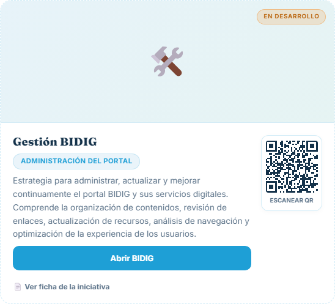
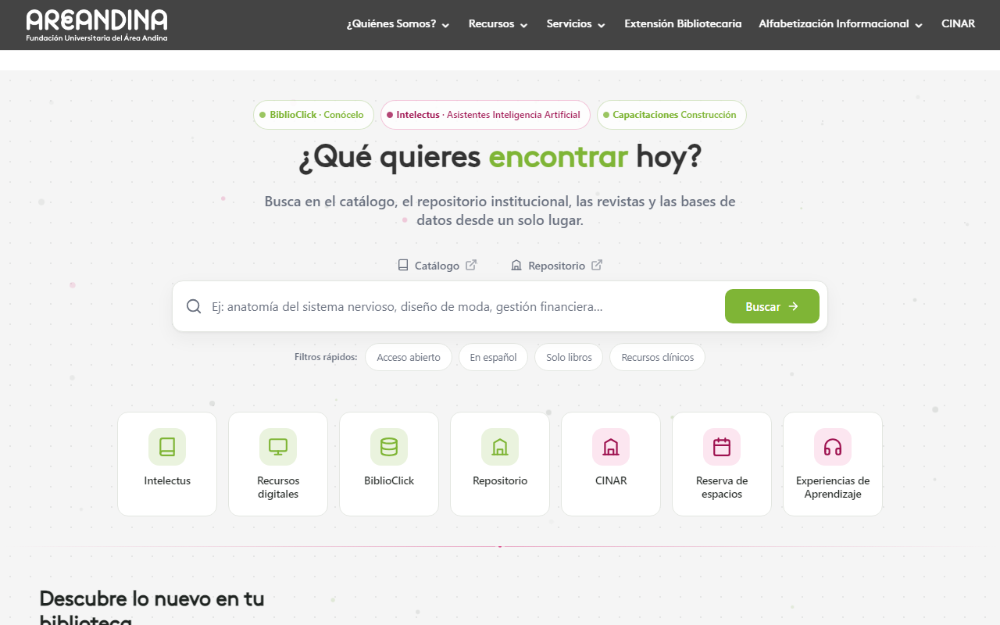

# 02 · Gestión BIDIG

**Administración del portal** · Experiencia al Usuario · Estado en el tablero: **En desarrollo**

## Qué es

Estrategia para administrar, actualizar y mejorar continuamente el portal BIDIG y sus servicios digitales. Comprende la organización de contenidos, revisión de enlaces, actualización de recursos, análisis de navegación y optimización de la experiencia de los usuarios.

- **Definición:** Estrategia para administrar, actualizar y mejorar continuamente el portal BIDIG y sus servicios digitales.
- **Descripción técnica:** Comprende la organización de contenidos, revisión de enlaces, actualización de recursos, análisis de navegación y optimización de la experiencia de los usuarios.

## En el tablero

## En la biblioteca digital (bidig)

- [BIDIG](https://bidig.areandina.edu.co/)

  

## Enlaces

- https://bidig.areandina.edu.co/

## Verificación

Revisado el 2026-11-14: búsqueda en bidig y captura de las páginas citadas. Que una página cargue no prueba el funcionamiento del servicio; los enlaces externos (Gemini, Odilo, Looker) piden sesión y no se capturaron.
