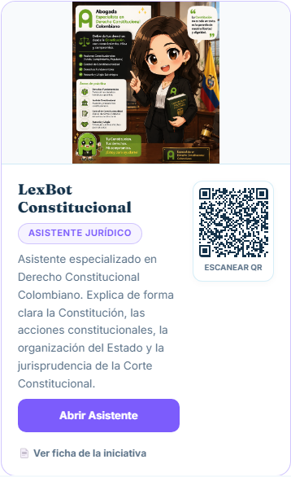
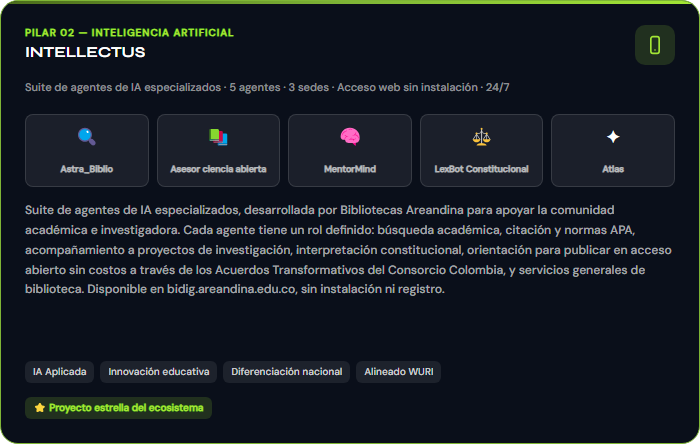
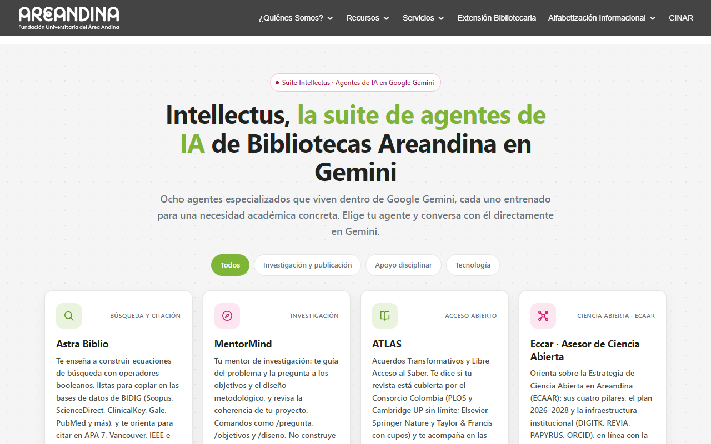

# 05 · LexBot Constitucional

**Asistente jurídico** · Experiencia al Usuario · Estado en el tablero: **En operación**

## Qué es

Asistente especializado en Derecho Constitucional Colombiano. Explica de forma clara la Constitución, las acciones constitucionales, la organización del Estado y la jurisprudencia de la Corte Constitucional.

- **Definición:** Agente de IA especializado en Derecho Constitucional Colombiano.
- **Descripción técnica:** Gem de Google Gemini entrenado con fuentes normativas y jurisprudenciales colombianas.
- **Objetivo:** Explicar de forma clara la Constitución, las acciones constitucionales, la organización del Estado y la jurisprudencia de la Corte Constitucional.
- **Comunidades:** Estudiantes y docentes de la Facultad de Derecho.

## En el tablero

## En la biblioteca digital (bidig)

Tarjeta en [BiblioNova en bidig](https://bidig.areandina.edu.co/main-home/biblionova/) — estado allí: **en producción**.

> PILAR 02 — INTELIGENCIA ARTIFICIAL
> INTELLECTUS
> Suite de agentes de IA especializados · 5 agentes · 3 sedes · Acceso web sin instalación · 24/7
> 🔍
> Astra_Biblio
> 📚
> Asesor ciencia abierta
> 🧠
> MentorMind
> ⚖️
> LexBot Constitucional
> ✦

- [Intellectus Areandina: suite de agentes de inteligencia artificial | Bibliotecas Areandina](https://bidig.areandina.edu.co/main-home/asistentes-de-ia/)

  

## Enlaces

- https://gemini.google.com/gem/bb2c21657470?usp=sharing

## Verificación

Revisado el 2026-11-14: búsqueda en bidig y captura de las páginas citadas. Que una página cargue no prueba el funcionamiento del servicio; los enlaces externos (Gemini, Odilo, Looker) piden sesión y no se capturaron.
