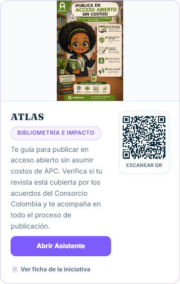
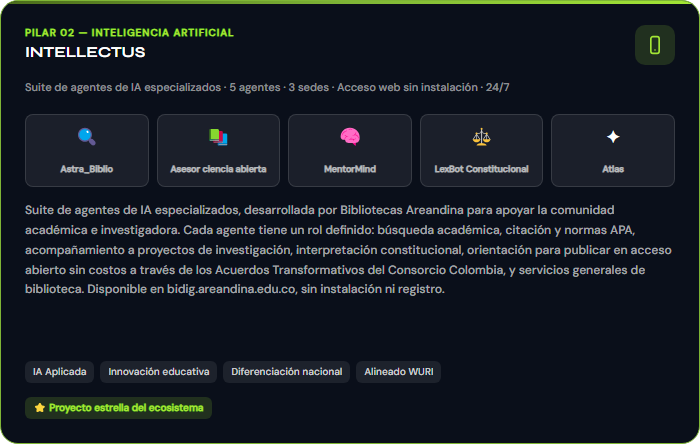
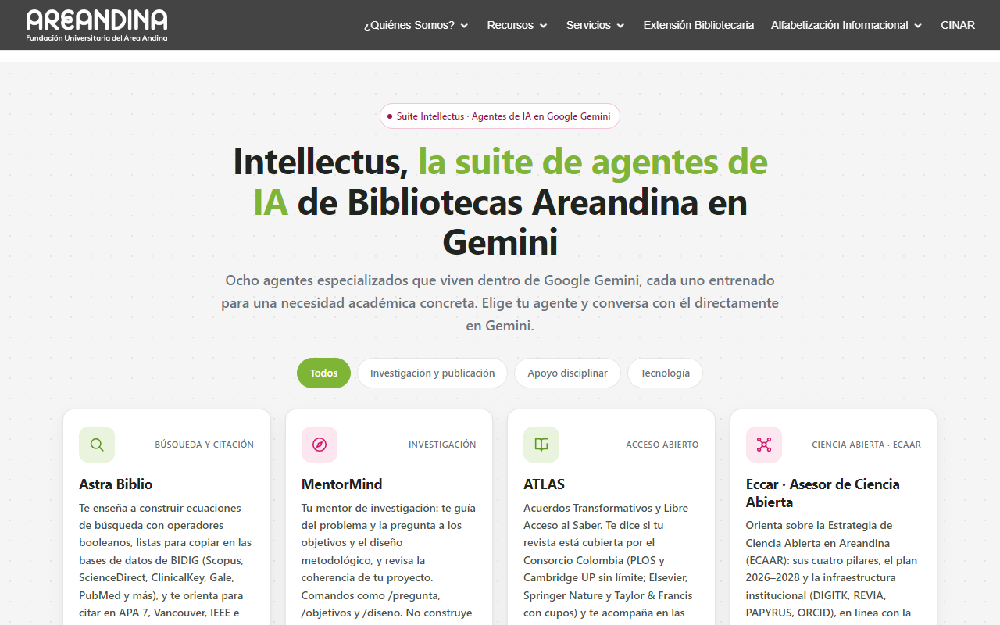

# 07 · ATLAS

**Bibliometría e impacto** · Experiencia al Usuario · Estado en el tablero: **En operación**

## Qué es

Te guía para publicar en acceso abierto sin asumir costos de APC. Verifica si tu revista está cubierta por los acuerdos del Consorcio Colombia y te acompaña en todo el proceso de publicación.

- **Definición:** Agente de IA que guía el proceso de publicación en acceso abierto sin costos de APC.
- **Descripción técnica:** Gem de Google Gemini con los acuerdos transformativos del Consorcio Colombia.
- **Objetivo:** Ampliar la visibilidad de la producción científica institucional reduciendo las barreras económicas de publicación.
- **Comunidades:** Investigadores y docentes con producción científica.

## En el tablero

## En la biblioteca digital (bidig)

Tarjeta en [BiblioNova en bidig](https://bidig.areandina.edu.co/main-home/biblionova/) — estado allí: **en producción**.

> PILAR 02 — INTELIGENCIA ARTIFICIAL
> INTELLECTUS
> Suite de agentes de IA especializados · 5 agentes · 3 sedes · Acceso web sin instalación · 24/7
> 🔍
> Astra_Biblio
> 📚
> Asesor ciencia abierta
> 🧠
> MentorMind
> ⚖️
> LexBot Constitucional
> ✦

- [Intellectus Areandina: suite de agentes de inteligencia artificial | Bibliotecas Areandina](https://bidig.areandina.edu.co/main-home/asistentes-de-ia/)

  

## Enlaces

- https://gemini.google.com/gem/a48a02298c58?usp=sharing

## Verificación

Revisado el 2026-11-14: búsqueda en bidig y captura de las páginas citadas. Que una página cargue no prueba el funcionamiento del servicio; los enlaces externos (Gemini, Odilo, Looker) piden sesión y no se capturaron.
