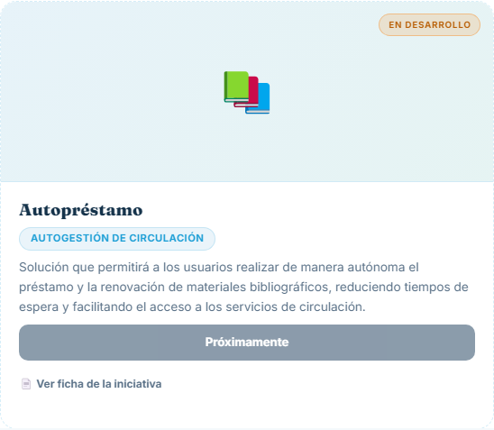

# 08 · Autopréstamo

**Autogestión de circulación** · Experiencia al Usuario · Estado en el tablero: **En desarrollo**

## Qué es

Solución que permitirá a los usuarios realizar de manera autónoma el préstamo y la renovación de materiales bibliográficos, reduciendo tiempos de espera y facilitando el acceso a los servicios de circulación.

- **Definición:** Solución de autogestión para el préstamo y la renovación autónoma de materiales bibliográficos.
- **Descripción técnica:** Permitirá al usuario ejecutar la transacción de préstamo y renovación sin intermediación del personal de circulación.
- **Objetivo:** Reducir tiempos de espera y facilitar el acceso a los servicios de circulación.

## En el tablero

## En la biblioteca digital (bidig)

No se encontró esta iniciativa en bidig (búsqueda en el sitio y revisión de las páginas de BiblioNova, Intelectus, CINAR, servicios y alfabetización, 2026-11-14). Pendiente de publicar o de confirmar con quien la lidera.

## Verificación

Revisado el 2026-11-14: búsqueda en bidig y captura de las páginas citadas. Que una página cargue no prueba el funcionamiento del servicio; los enlaces externos (Gemini, Odilo, Looker) piden sesión y no se capturaron.
