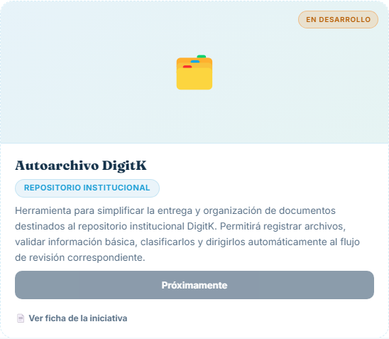
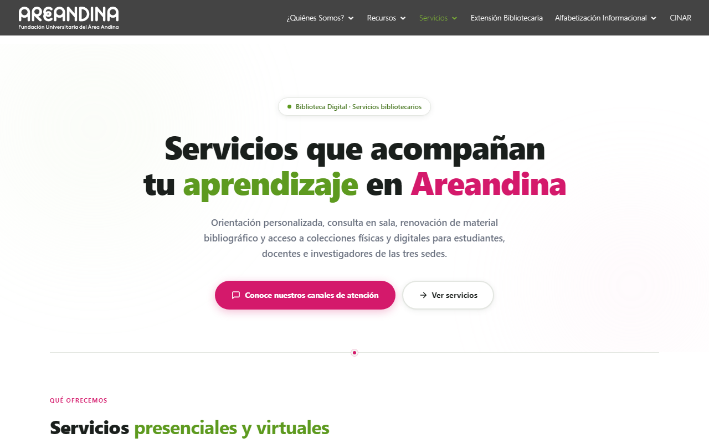

# 09 · Autoarchivo DigitK

**Repositorio institucional** · Experiencia al Usuario · Estado en el tablero: **En desarrollo**

## Qué es

Herramienta para simplificar la entrega y organización de documentos destinados al repositorio institucional DigitK. Permitirá registrar archivos, validar información básica, clasificarlos y dirigirlos automáticamente al flujo de revisión correspondiente.

- **Definición:** Herramienta de autoarchivo para la entrega y organización de documentos destinados al repositorio institucional DigitK.
- **Descripción técnica:** Permitirá registrar archivos, validar información básica, clasificarlos y dirigirlos automáticamente al flujo de revisión correspondiente.
- **Objetivo:** Simplificar el depósito de la producción académica en el repositorio institucional.

## En el tablero

## En la biblioteca digital (bidig)

Solo aparece mencionada dentro de otras páginas; no tiene página propia.

- [Servicios básicos ](https://bidig.areandina.edu.co/main-home/servicios/servicios-basicos/)

  

## Enlaces

- https://digitk.areandina.edu.co/

## Verificación

Revisado el 2026-11-14: búsqueda en bidig y captura de las páginas citadas. Que una página cargue no prueba el funcionamiento del servicio; los enlaces externos (Gemini, Odilo, Looker) piden sesión y no se capturaron.
