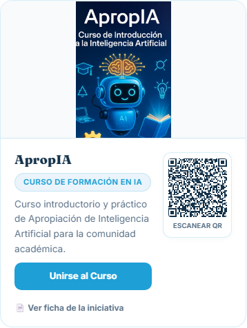
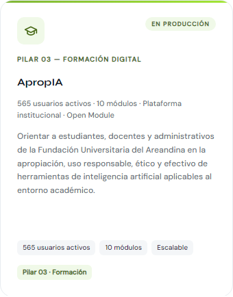
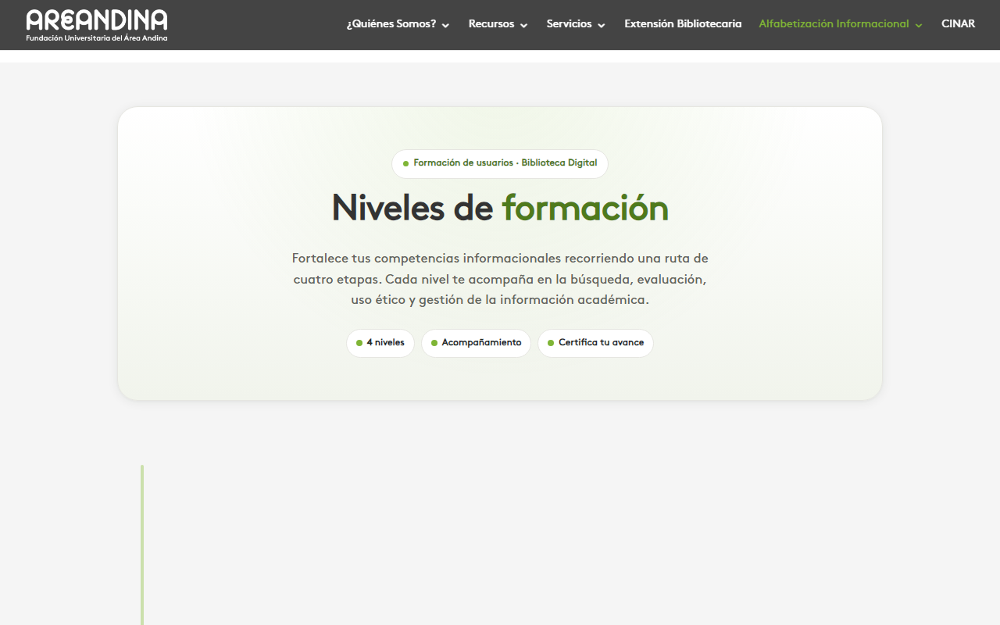

# 10 · ApropIA

**Curso de formación en IA** · Experiencia al Usuario · Estado en el tablero: **En operación**

## Qué es

Curso introductorio y práctico de Apropiación de Inteligencia Artificial para la comunidad académica.

- **Definición:** Curso introductorio y práctico de apropiación de Inteligencia Artificial para la comunidad académica.
- **Descripción técnica:** Experiencia de aprendizaje alojada en la plataforma Odilo (Areandina EA).
- **Objetivo:** Desarrollar competencias básicas de uso responsable y crítico de la Inteligencia Artificial.
- **Comunidades:** Comunidad académica Areandina.

## En el tablero

## En la biblioteca digital (bidig)

Tarjeta en [BiblioNova en bidig](https://bidig.areandina.edu.co/main-home/biblionova/) — estado allí: **en producción**.

> PILAR 03 — FORMACIÓN DIGITAL
> ApropIA
> 565 usuarios activos · 10 módulos · Plataforma institucional · Open Module
> Orientar a estudiantes, docentes y administrativos de la Fundación Universitaria del Areandina en la apropiación, uso responsable, ético y efectivo de herramientas de inteligencia artificial aplicables al entorno académico.
> 565 usuarios activos
> 10 módulos
> Escalable
> Pilar 03 · Formación

- [Niveles de formación](https://bidig.areandina.edu.co/main-home/alfabetizacion-informacional/2851-2/)

  

## Enlaces

- https://areandina-ea.odilotk.es/clubs/join-experience/6RIEKDRV

## Verificación

Revisado el 2026-11-14: búsqueda en bidig y captura de las páginas citadas. Que una página cargue no prueba el funcionamiento del servicio; los enlaces externos (Gemini, Odilo, Looker) piden sesión y no se capturaron.
