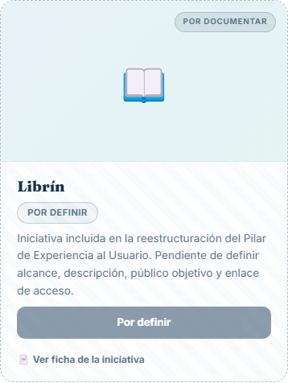
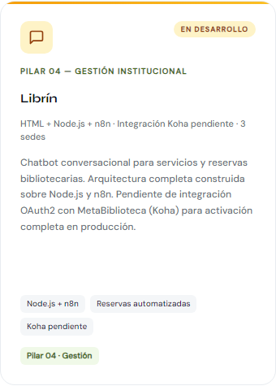
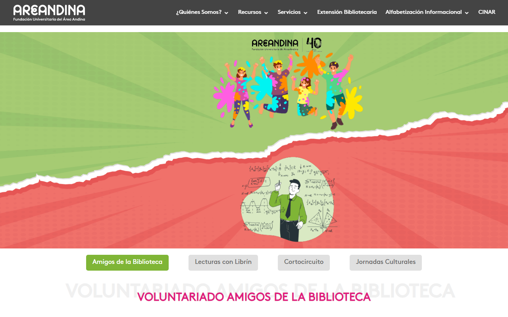

# 11 · Librín

**Por definir** · Experiencia al Usuario · Estado en el tablero: **Por documentar / definir**

## Qué es

Iniciativa incluida en la reestructuración del Pilar de Experiencia al Usuario. Pendiente de definir alcance, descripción, público objetivo y enlace de acceso.

## En el tablero

## En la biblioteca digital (bidig)

Tarjeta en [BiblioNova en bidig](https://bidig.areandina.edu.co/main-home/biblionova/) — estado allí: **en desarrollo**.

> PILAR 04 — GESTIÓN INSTITUCIONAL
> Librín
> HTML + Node.js + n8n · Integración Koha pendiente · 3 sedes
> Chatbot conversacional para servicios y reservas bibliotecarias. Arquitectura completa construida sobre Node.js y n8n. Pendiente de integración OAuth2 con MetaBiblioteca (Koha) para activación completa en producción.
> Node.js + n8n
> Reservas automatizadas
> Koha pendiente
> Pilar 04 · Gestión

- [Extensión cultural - Rework](https://bidig.areandina.edu.co/main-home/extension-cultural-rework/)

  

## Observaciones

- El tablero dice **Por documentar / definir** y bidig dice **en desarrollo**. Hay que unificar el estado.

## Verificación

Revisado el 2026-11-14: búsqueda en bidig y captura de las páginas citadas. Que una página cargue no prueba el funcionamiento del servicio; los enlaces externos (Gemini, Odilo, Looker) piden sesión y no se capturaron.
