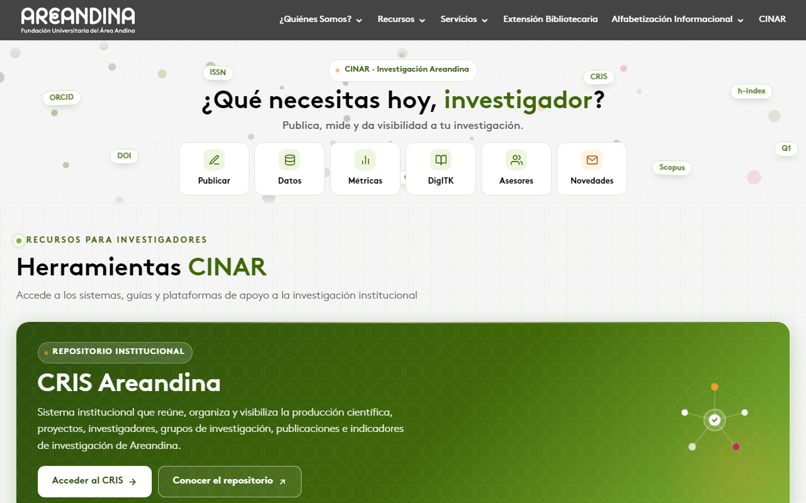

# 12 · Google Scholar

**Formación investigativa** · Experiencia al Usuario · Estado en el tablero: **En operación**

## Qué es

Crea y optimiza tu perfil en Google Scholar para la gestión de citas y posicionamiento científico.

- **Definición:** Experiencia formativa para crear y optimizar el perfil en Google Scholar.
- **Descripción técnica:** Experiencia de aprendizaje alojada en la plataforma Odilo (Areandina EA).
- **Objetivo:** Mejorar la gestión de citas y el posicionamiento científico de los investigadores.
- **Comunidades:** Docentes e investigadores.

## En el tablero

## En la biblioteca digital (bidig)

Solo aparece mencionada dentro de otras páginas; no tiene página propia.

- [CINAR Areandina: Centro de Información para la Investigación | Bibliotecas Areandina](https://bidig.areandina.edu.co/main-home/cinar-rework-copy-nueva-version/)

  

## Enlaces

- https://areandina-ea.odilotk.es/clubs/join-experience/UC0Z5ZSW

## Verificación

Revisado el 2026-11-14: búsqueda en bidig y captura de las páginas citadas. Que una página cargue no prueba el funcionamiento del servicio; los enlaces externos (Gemini, Odilo, Looker) piden sesión y no se capturaron.
