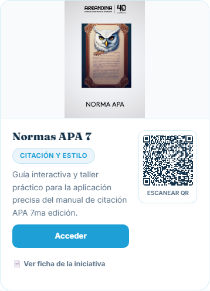
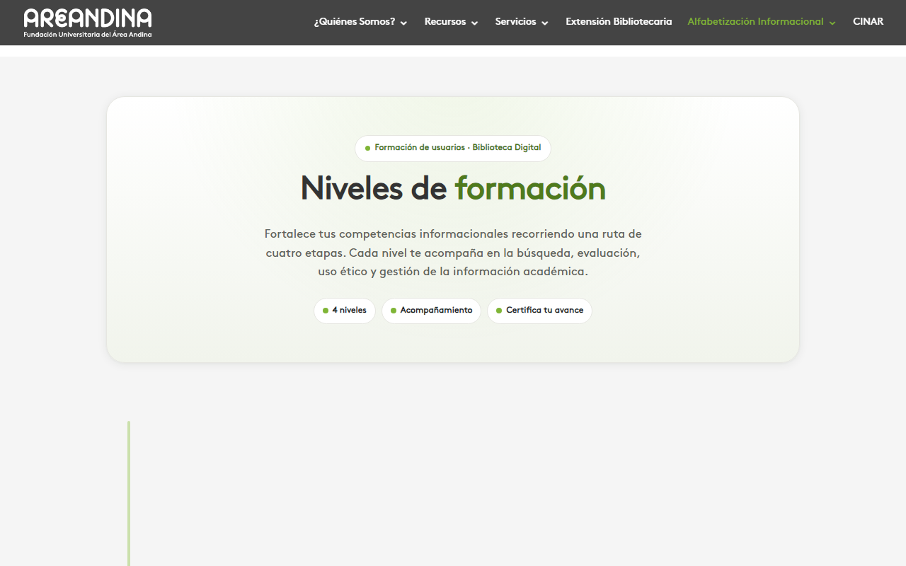

# 13 · Normas APA 7

**Citación y estilo** · Experiencia al Usuario · Estado en el tablero: **En operación**

## Qué es

Guía interactiva y taller práctico para la aplicación precisa del manual de citación APA 7ma edición.

- **Definición:** Guía interactiva y taller práctico del manual de citación APA 7ma edición.
- **Descripción técnica:** Experiencia de aprendizaje alojada en la plataforma Odilo (Areandina EA).
- **Objetivo:** Asegurar la aplicación precisa de las normas de citación APA en los trabajos académicos.
- **Comunidades:** Estudiantes y docentes de todas las facultades.

## En el tablero

## En la biblioteca digital (bidig)

Solo aparece mencionada dentro de otras páginas; no tiene página propia.

- [Niveles de formación](https://bidig.areandina.edu.co/main-home/alfabetizacion-informacional/2851-2/)

  

## Enlaces

- https://areandina-ea.odilotk.es/clubs/join-experience/UC0Z5ZSW

## Verificación

Revisado el 2026-11-14: búsqueda en bidig y captura de las páginas citadas. Que una página cargue no prueba el funcionamiento del servicio; los enlaces externos (Gemini, Odilo, Looker) piden sesión y no se capturaron.
