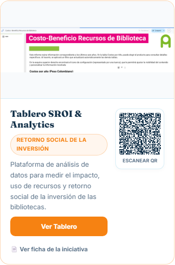
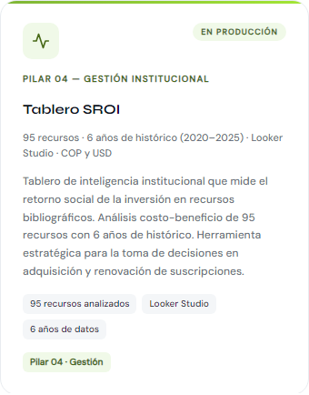

# 15 · Tablero SROI & Analytics

**Retorno social de la inversión** · Gestión Institucional · Estado en el tablero: **En operación**

## Qué es

Plataforma de análisis de datos para medir el impacto, uso de recursos y retorno social de la inversión de las bibliotecas.

- **Definición:** Plataforma de análisis de datos que mide el impacto, el uso de recursos y el retorno social de la inversión de las bibliotecas.
- **Descripción técnica:** Tablero desarrollado en Looker Studio sobre las fuentes de datos de uso de recursos.
- **Objetivo:** Transformar los datos de uso en decisiones estratégicas y evidenciar el valor social de la biblioteca.
- **Comunidades:** Dirección de Bibliotecas, decanaturas y áreas administrativas.

## En el tablero

## En la biblioteca digital (bidig)

Tarjeta en [BiblioNova en bidig](https://bidig.areandina.edu.co/main-home/biblionova/) — estado allí: **en producción**.

> PILAR 04 — GESTIÓN INSTITUCIONAL
> Tablero SROI
> 95 recursos · 6 años de histórico (2020–2025) · Looker Studio · COP y USD
> Tablero de inteligencia institucional que mide el retorno social de la inversión en recursos bibliográficos. Análisis costo-beneficio de 95 recursos con 6 años de histórico. Herramienta estratégica para la toma de decisiones en adquisición y renovación de suscripciones.
> 95 recursos analizados
> Looker Studio
> 6 años de datos
> Pilar 04 · Gestión

## Enlaces

- https://lookerstudio.google.com/u/0/reporting/17154eb5-e2f9-4b6d-9787-8df0c6ff7eb1/page/p_h1x8i4u5ld

## Verificación

Revisado el 2026-11-14: búsqueda en bidig y captura de las páginas citadas. Que una página cargue no prueba el funcionamiento del servicio; los enlaces externos (Gemini, Odilo, Looker) piden sesión y no se capturaron.
