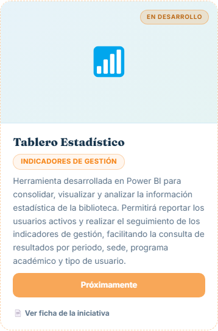

# 16 · Tablero Estadístico

**Indicadores de gestión** · Gestión Institucional · Estado en el tablero: **En desarrollo**

## Qué es

Herramienta desarrollada en Power BI para consolidar, visualizar y analizar la información estadística de la biblioteca. Permitirá reportar los usuarios activos y realizar el seguimiento de los indicadores de gestión, facilitando la consulta de resultados por periodo, sede, programa académico y tipo de usuario.

- **Definición:** Herramienta para consolidar, visualizar y analizar la información estadística de la biblioteca.
- **Descripción técnica:** Desarrollada en Power BI. Permitirá reportar los usuarios activos y hacer seguimiento a los indicadores de gestión, con consulta de resultados por periodo, sede, programa académico y tipo de usuario.
- **Objetivo:** Fortalecer el monitoreo del desempeño y la toma de decisiones basada en datos.

## En el tablero

## En la biblioteca digital (bidig)

No se encontró esta iniciativa en bidig (búsqueda en el sitio y revisión de las páginas de BiblioNova, Intelectus, CINAR, servicios y alfabetización, 2026-11-14). Pendiente de publicar o de confirmar con quien la lidera.

## Verificación

Revisado el 2026-11-14: búsqueda en bidig y captura de las páginas citadas. Que una página cargue no prueba el funcionamiento del servicio; los enlaces externos (Gemini, Odilo, Looker) piden sesión y no se capturaron.
