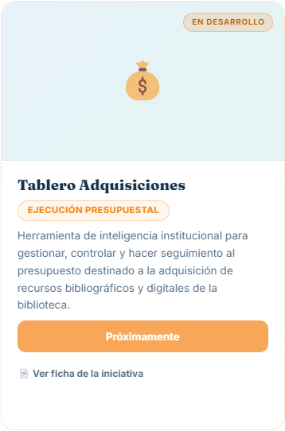

# 17 · Tablero Adquisiciones

**Ejecución presupuestal** · Gestión Institucional · Estado en el tablero: **En desarrollo**

## Qué es

Herramienta de inteligencia institucional para gestionar, controlar y hacer seguimiento al presupuesto destinado a la adquisición de recursos bibliográficos y digitales de la biblioteca.

- **Definición:** Herramienta de inteligencia institucional diseñada para gestionar, controlar y hacer seguimiento al presupuesto destinado a la adquisición de recursos bibliográficos y digitales de la biblioteca.
- **Descripción técnica:** Permitirá visualizar la ejecución presupuestal por sede, facultad, programa académico, tipo de recurso y proveedor; comparar el presupuesto asignado, comprometido y ejecutado; y generar alertas.
- **Objetivo:** Apoyar la planeación y la toma de decisiones sobre la inversión en recursos bibliográficos.

## En el tablero

## En la biblioteca digital (bidig)

No se encontró esta iniciativa en bidig (búsqueda en el sitio y revisión de las páginas de BiblioNova, Intelectus, CINAR, servicios y alfabetización, 2026-11-14). Pendiente de publicar o de confirmar con quien la lidera.

## Verificación

Revisado el 2026-11-14: búsqueda en bidig y captura de las páginas citadas. Que una página cargue no prueba el funcionamiento del servicio; los enlaces externos (Gemini, Odilo, Looker) piden sesión y no se capturaron.
