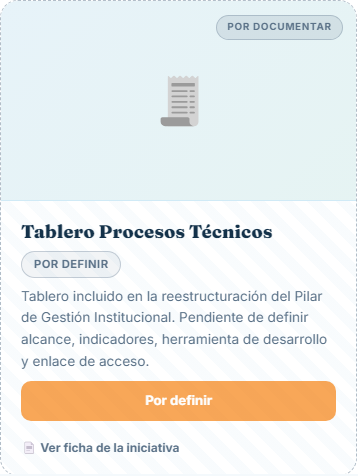

# 18 · Tablero Procesos Técnicos

**Por definir** · Gestión Institucional · Estado en el tablero: **Por documentar / definir**

## Qué es

Tablero incluido en la reestructuración del Pilar de Gestión Institucional. Pendiente de definir alcance, indicadores, herramienta de desarrollo y enlace de acceso.

## En el tablero

## En la biblioteca digital (bidig)

No se encontró esta iniciativa en bidig (búsqueda en el sitio y revisión de las páginas de BiblioNova, Intelectus, CINAR, servicios y alfabetización, 2026-11-14). Pendiente de publicar o de confirmar con quien la lidera.

## Verificación

Revisado el 2026-11-14: búsqueda en bidig y captura de las páginas citadas. Que una página cargue no prueba el funcionamiento del servicio; los enlaces externos (Gemini, Odilo, Looker) piden sesión y no se capturaron.
