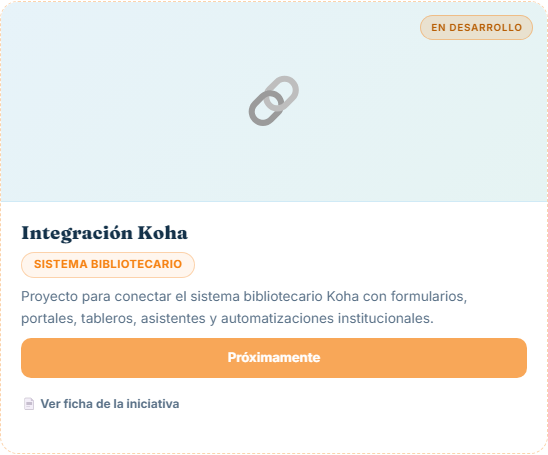
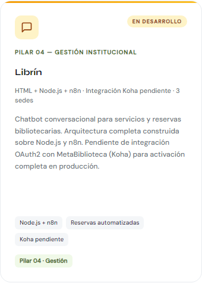

# 19 · Integración Koha

**Sistema bibliotecario** · Gestión Institucional · Estado en el tablero: **En desarrollo**

## Qué es

Proyecto para conectar el sistema bibliotecario Koha con formularios, portales, tableros, asistentes y automatizaciones institucionales.

- **Definición:** Proyecto para conectar el sistema bibliotecario Koha con formularios, portales, tableros, asistentes y automatizaciones institucionales.
- **Descripción técnica:** Permitirá consultar información actualizada sobre usuarios, préstamos, colecciones y disponibilidad.
- **Objetivo:** Evitar registros duplicados y procesos manuales en todo el ecosistema.

## En el tablero

## En la biblioteca digital (bidig)

Solo aparece mencionada dentro de otras páginas; no tiene página propia.

Tarjeta en [BiblioNova en bidig](https://bidig.areandina.edu.co/main-home/biblionova/) — estado allí: **en desarrollo**.

> PILAR 04 — GESTIÓN INSTITUCIONAL
> Librín
> HTML + Node.js + n8n · Integración Koha pendiente · 3 sedes
> Chatbot conversacional para servicios y reservas bibliotecarias. Arquitectura completa construida sobre Node.js y n8n. Pendiente de integración OAuth2 con MetaBiblioteca (Koha) para activación completa en producción.
> Node.js + n8n
> Reservas automatizadas
> Koha pendiente
> Pilar 04 · Gestión

## Verificación

Revisado el 2026-11-14: búsqueda en bidig y captura de las páginas citadas. Que una página cargue no prueba el funcionamiento del servicio; los enlaces externos (Gemini, Odilo, Looker) piden sesión y no se capturaron.
