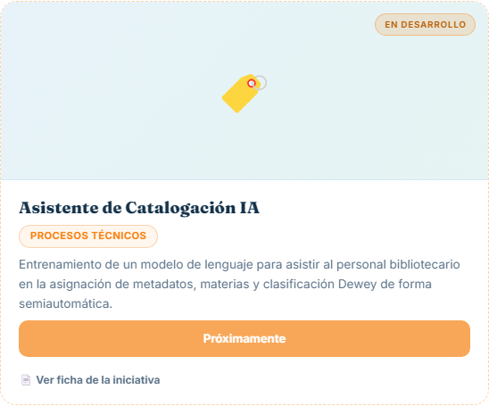

# 20 · Asistente de Catalogación IA

**Procesos técnicos** · Gestión Institucional · Estado en el tablero: **En desarrollo**

## Qué es

Entrenamiento de un modelo de lenguaje para asistir al personal bibliotecario en la asignación de metadatos, materias y clasificación Dewey de forma semiautomática.

- **Definición:** Modelo de lenguaje que asiste al personal bibliotecario en la catalogación.
- **Descripción técnica:** Asignación semiautomática de metadatos, materias y clasificación Dewey.
- **Objetivo:** Reducir el tiempo de procesamiento técnico y homogeneizar la calidad de los registros.
- **Comunidades:** Personal de procesos técnicos de las Bibliotecas Areandina.

## En el tablero

## En la biblioteca digital (bidig)

No se encontró esta iniciativa en bidig (búsqueda en el sitio y revisión de las páginas de BiblioNova, Intelectus, CINAR, servicios y alfabetización, 2026-11-14). Pendiente de publicar o de confirmar con quien la lidera.

## Verificación

Revisado el 2026-11-14: búsqueda en bidig y captura de las páginas citadas. Que una página cargue no prueba el funcionamiento del servicio; los enlaces externos (Gemini, Odilo, Looker) piden sesión y no se capturaron.
