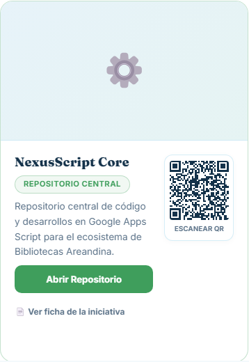
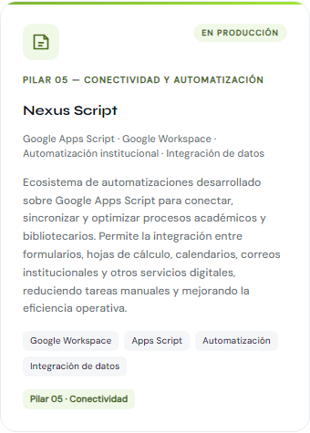

# 21 · NexusScript Core

**Repositorio central** · Gestión Institucional · Estado en el tablero: **En operación**

## Qué es

Repositorio central de código y desarrollos en Google Apps Script para el ecosistema de Bibliotecas Areandina.

- **Definición:** Repositorio central de código y desarrollos en Google Apps Script del ecosistema BiblioNova.
- **Descripción técnica:** Base de código común de los flujos que conectan Google Forms, Sheets, Gmail y Looker Studio.
- **Objetivo:** Centralizar, versionar y reutilizar los desarrollos de automatización de las bibliotecas.
- **Comunidades:** Equipo de Bibliotecas Areandina.

## En el tablero

## En la biblioteca digital (bidig)

Tarjeta en [BiblioNova en bidig](https://bidig.areandina.edu.co/main-home/biblionova/) — estado allí: **en producción**.

> PILAR 05 — CONECTIVIDAD Y AUTOMATIZACIÓN
> Nexus Script
> Google Apps Script · Google Workspace · Automatización institucional · Integración de datos
> Ecosistema de automatizaciones desarrollado sobre Google Apps Script para conectar, sincronizar y optimizar procesos académicos y bibliotecarios. Permite la integración entre formularios, hojas de cálculo, calendarios, correos institucionales y otros servicios digitales, reduciendo tareas manuales y mejorando la eficiencia operativa.
> Google Workspace
> Apps Script
> Automatización
> Integración de datos
> Pilar 05 · Conectividad

## Enlaces

- https://github.com/nexusscript-core

## Verificación

Revisado el 2026-11-14: búsqueda en bidig y captura de las páginas citadas. Que una página cargue no prueba el funcionamiento del servicio; los enlaces externos (Gemini, Odilo, Looker) piden sesión y no se capturaron.
