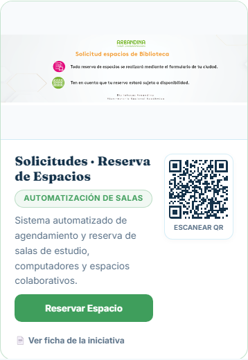
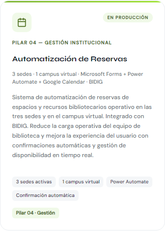
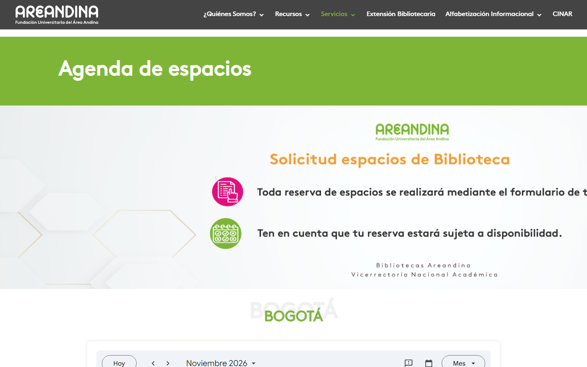
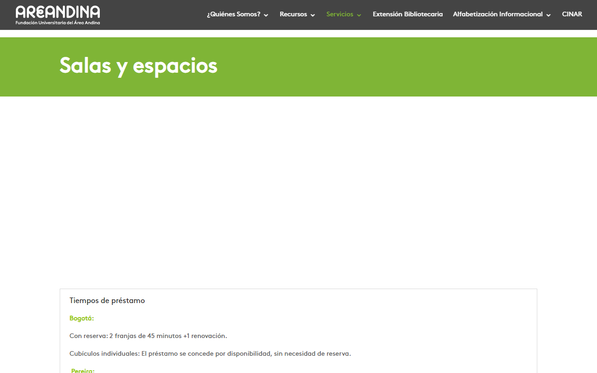

# 22 · Solicitudes · Reserva de Espacios

**Automatización de salas** · Gestión Institucional · Estado en el tablero: **En operación**

## Qué es

Sistema automatizado de agendamiento y reserva de salas de estudio, computadores y espacios colaborativos.

- **Definición:** Sistema automatizado de agendamiento y reserva de salas de estudio, computadores y espacios colaborativos.
- **Descripción técnica:** Flujo Google Forms → Apps Script → Gmail → Sheets con registro centralizado.
- **Objetivo:** Optimizar el uso de los espacios físicos y eliminar la gestión manual de reservas.
- **Comunidades:** Estudiantes y docentes usuarios de los espacios de biblioteca.

## En el tablero

## En la biblioteca digital (bidig)

Tarjeta en [BiblioNova en bidig](https://bidig.areandina.edu.co/main-home/biblionova/) — estado allí: **en producción**.

> PILAR 04 — GESTIÓN INSTITUCIONAL
> Automatización de Reservas
> 3 sedes · 1 campus virtual · Microsoft Forms + Power Automate + Google Calendar · BIDIG
> Sistema de automatización de reservas de espacios y recursos bibliotecarios operativo en las tres sedes y en el campus virtual. Integrado con BIDIG. Reduce la carga operativa del equipo de biblioteca y mejora la experiencia del usuario con confirmaciones automáticas y gestión de disponibilidad en tiempo real.
> 3 sedes activas
> 1 campus virtual
> Power Automate
> Confirmación automática
> Pilar 04 · Gestión

- [Agenda de Espacios](https://bidig.areandina.edu.co/main-home/servicios/agenda-espacios/)

  

- [Salas y espacios](https://bidig.areandina.edu.co/main-home/servicios/salas-y-espacios/)

  

## Enlaces

- https://bidig.areandina.edu.co/

## Verificación

Revisado el 2026-11-14: búsqueda en bidig y captura de las páginas citadas. Que una página cargue no prueba el funcionamiento del servicio; los enlaces externos (Gemini, Odilo, Looker) piden sesión y no se capturaron.
