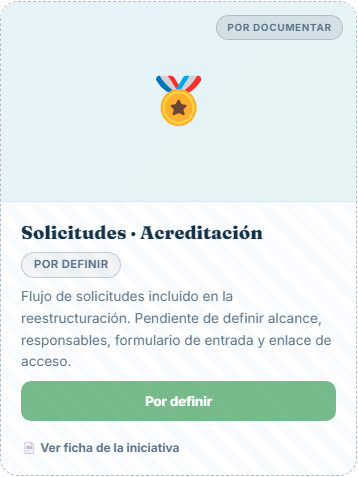
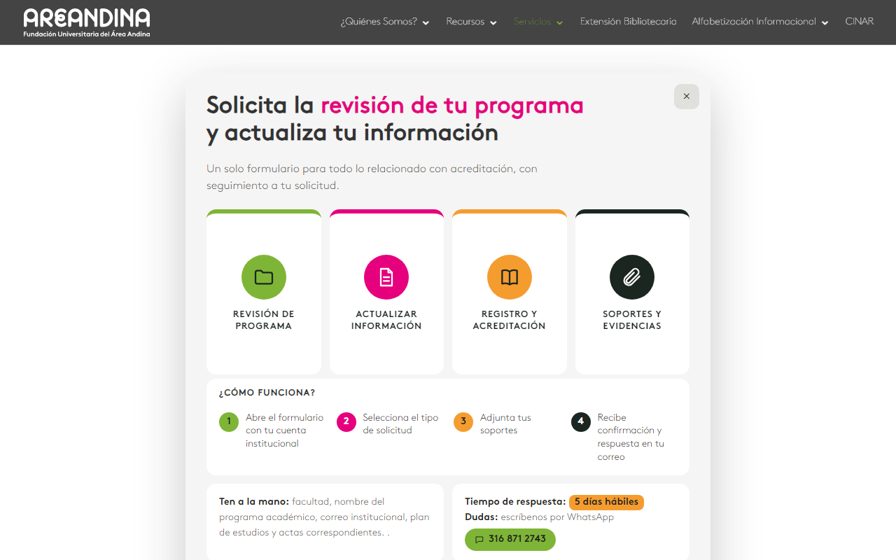

# 24 · Solicitudes · Acreditación

**Por definir** · Gestión Institucional · Estado en el tablero: **Por documentar / definir**

## Qué es

Flujo de solicitudes incluido en la reestructuración. Pendiente de definir alcance, responsables, formulario de entrada y enlace de acceso.

## En el tablero

## En la biblioteca digital (bidig)

- [Solicitud Acreditación](https://bidig.areandina.edu.co/main-home/propuesta-servicios/)

  

## Verificación

Revisado el 2026-11-14: búsqueda en bidig y captura de las páginas citadas. Que una página cargue no prueba el funcionamiento del servicio; los enlaces externos (Gemini, Odilo, Looker) piden sesión y no se capturaron.
