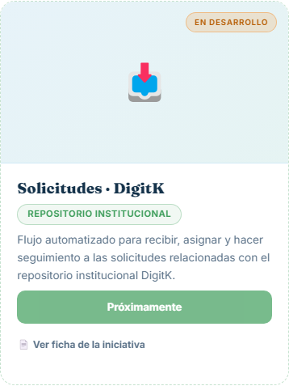
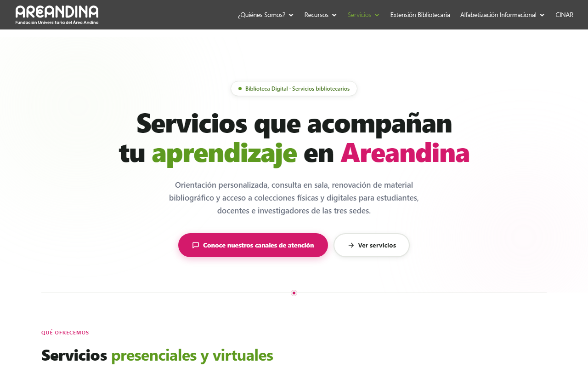

# 25 · Solicitudes · DigitK

**Repositorio institucional** · Gestión Institucional · Estado en el tablero: **En desarrollo**

## Qué es

Flujo automatizado para recibir, asignar y hacer seguimiento a las solicitudes relacionadas con el repositorio institucional DigitK.

- **Definición:** Flujo automatizado para recibir, asignar y hacer seguimiento a las solicitudes relacionadas con el repositorio institucional DigitK.
- **Descripción técnica:** Incluirá notificaciones, responsables, estados, tiempos de atención y evidencias de cierre.
- **Objetivo:** Trazabilidad completa de las solicitudes del repositorio institucional.

## En el tablero

## En la biblioteca digital (bidig)

Solo aparece mencionada dentro de otras páginas; no tiene página propia.

- [Servicios básicos ](https://bidig.areandina.edu.co/main-home/servicios/servicios-basicos/)

  

## Verificación

Revisado el 2026-11-14: búsqueda en bidig y captura de las páginas citadas. Que una página cargue no prueba el funcionamiento del servicio; los enlaces externos (Gemini, Odilo, Looker) piden sesión y no se capturaron.
