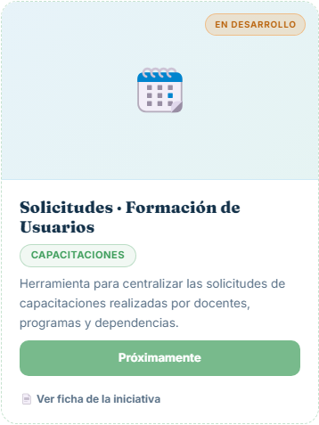
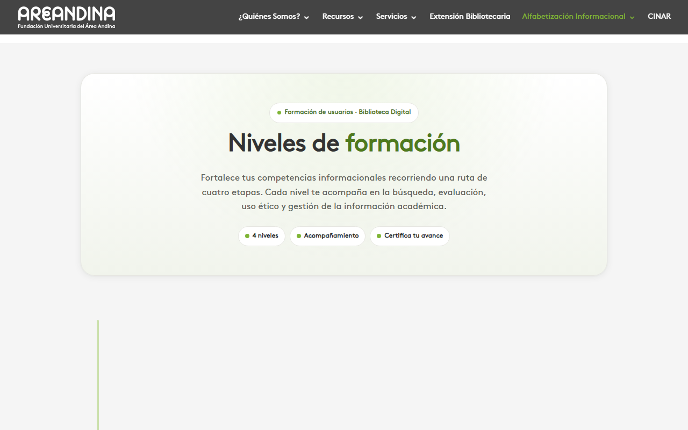

# 26 · Solicitudes · Formación de Usuarios

**Capacitaciones** · Gestión Institucional · Estado en el tablero: **En desarrollo**

## Qué es

Herramienta para centralizar las solicitudes de capacitaciones realizadas por docentes, programas y dependencias.

- **Definición:** Herramienta para centralizar las solicitudes de capacitaciones realizadas por docentes, programas y dependencias.
- **Descripción técnica:** Automatizará el registro, la asignación del bibliotecario, la programación, las confirmaciones, la asistencia y la consolidación de resultados.
- **Objetivo:** Ordenar la demanda de formación y medir su cobertura real.
- **Comunidades:** Docentes, programas académicos y dependencias.

## En el tablero

## En la biblioteca digital (bidig)

Solo aparece mencionada dentro de otras páginas; no tiene página propia.

- [Niveles de formación](https://bidig.areandina.edu.co/main-home/alfabetizacion-informacional/2851-2/)

  

## Verificación

Revisado el 2026-11-14: búsqueda en bidig y captura de las páginas citadas. Que una página cargue no prueba el funcionamiento del servicio; los enlaces externos (Gemini, Odilo, Looker) piden sesión y no se capturaron.
