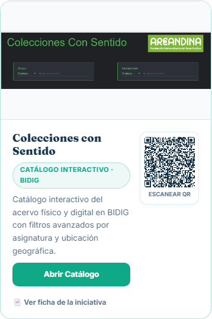
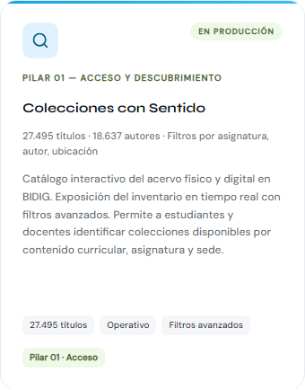

# 27 · Colecciones con Sentido

**Catálogo interactivo · BIDIG** · Academia · Estado en el tablero: **En operación**

## Qué es

Catálogo interactivo del acervo físico y digital en BIDIG con filtros avanzados por asignatura y ubicación geográfica.

- **Definición:** Catálogo interactivo del acervo físico y digital publicado en BIDIG.
- **Descripción técnica:** Tablero con filtros avanzados por asignatura y ubicación geográfica.
- **Objetivo:** Conectar la colección con los programas académicos y facilitar su descubrimiento.
- **Comunidades:** Docentes, estudiantes y comités curriculares.

## En el tablero

## En la biblioteca digital (bidig)

Tarjeta en [BiblioNova en bidig](https://bidig.areandina.edu.co/main-home/biblionova/) — estado allí: **en producción**.

> PILAR 01 — ACCESO Y DESCUBRIMIENTO
> Colecciones con Sentido
> 27.495 títulos · 18.637 autores · Filtros por asignatura, autor, ubicación
> Catálogo interactivo del acervo físico y digital en BIDIG. Exposición del inventario en tiempo real con filtros avanzados. Permite a estudiantes y docentes identificar colecciones disponibles por contenido curricular, asignatura y sede.
> 27.495 títulos
> Operativo
> Filtros avanzados
> Pilar 01 · Acceso

## Enlaces

- https://datastudio.google.com/u/0/reporting/45be3372-3bc9-4955-ae98-5285a9eba877?s=h0cUDW_LSyU

## Verificación

Revisado el 2026-11-14: búsqueda en bidig y captura de las páginas citadas. Que una página cargue no prueba el funcionamiento del servicio; los enlaces externos (Gemini, Odilo, Looker) piden sesión y no se capturaron.
