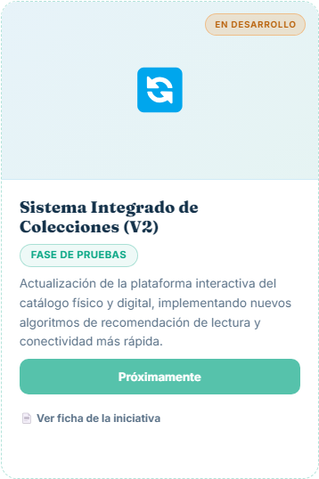

# 29 · Sistema Integrado de Colecciones (V2)

**Fase de pruebas** · Academia · Estado en el tablero: **En desarrollo**

## Qué es

Actualización de la plataforma interactiva del catálogo físico y digital, implementando nuevos algoritmos de recomendación de lectura y conectividad más rápida.

- **Definición:** Segunda versión de la plataforma interactiva del catálogo físico y digital.
- **Descripción técnica:** Nuevos algoritmos de recomendación de lectura y una capa de conectividad más rápida.
- **Objetivo:** Mejorar la pertinencia de las recomendaciones y el rendimiento de la consulta del catálogo.
- **Versiones:** V2 · en fase de pruebas.

## En el tablero

## En la biblioteca digital (bidig)

No se encontró esta iniciativa en bidig (búsqueda en el sitio y revisión de las páginas de BiblioNova, Intelectus, CINAR, servicios y alfabetización, 2026-11-14). Pendiente de publicar o de confirmar con quien la lidera.

## Observaciones

- Relacionada con **Colecciones con Sentido**; falta aclarar en qué se diferencia.

## Verificación

Revisado el 2026-11-14: búsqueda en bidig y captura de las páginas citadas. Que una página cargue no prueba el funcionamiento del servicio; los enlaces externos (Gemini, Odilo, Looker) piden sesión y no se capturaron.
