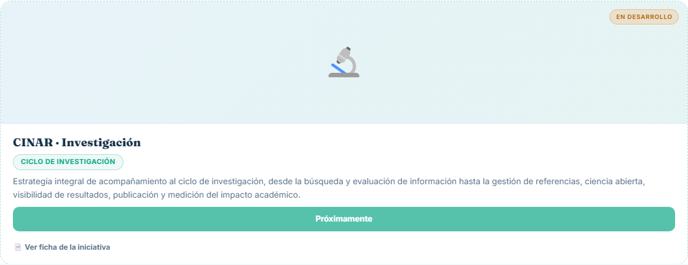
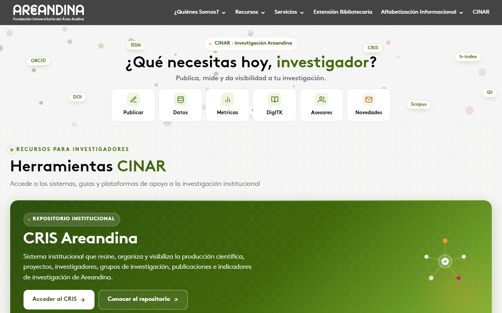

# 30 · CINAR · Investigación

**Ciclo de investigación** · Academia · Estado en el tablero: **En desarrollo**

## Qué es

Estrategia integral de acompañamiento al ciclo de investigación, desde la búsqueda y evaluación de información hasta la gestión de referencias, ciencia abierta, visibilidad de resultados, publicación y medición del impacto académico.

- **Definición:** Estrategia integral de acompañamiento al ciclo de investigación.
- **Descripción técnica:** Cubre búsqueda y evaluación de información, gestión de referencias, ciencia abierta, visibilidad de resultados, publicación y medición del impacto académico.
- **Objetivo:** Acompañar al investigador de extremo a extremo en todo el ciclo de investigación.
- **Comunidades:** Investigadores, semilleros y grupos de investigación.

## En el tablero

## En la biblioteca digital (bidig)

- [CINAR Areandina: Centro de Información para la Investigación | Bibliotecas Areandina](https://bidig.areandina.edu.co/main-home/cinar-rework-copy-nueva-version/)

  

## Verificación

Revisado el 2026-11-14: búsqueda en bidig y captura de las páginas citadas. Que una página cargue no prueba el funcionamiento del servicio; los enlaces externos (Gemini, Odilo, Looker) piden sesión y no se capturaron.
